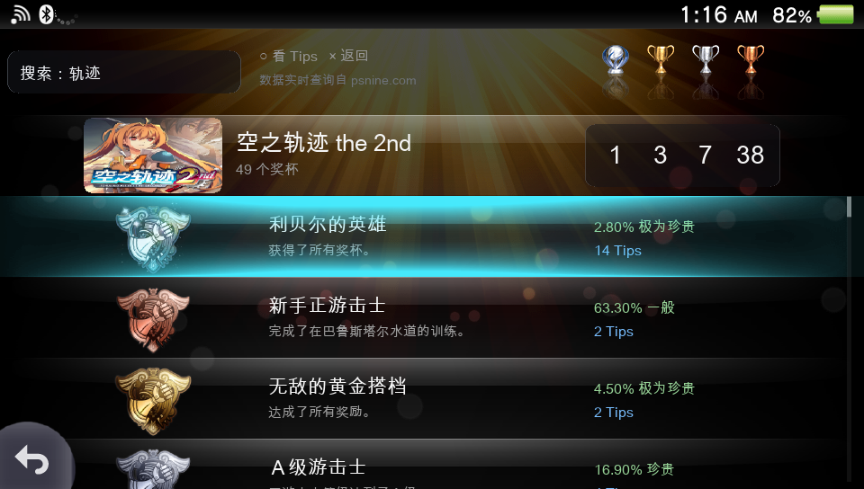
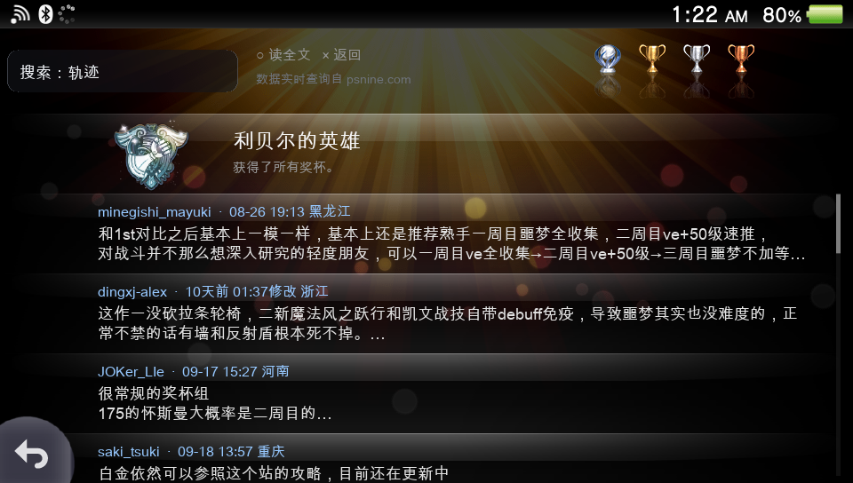

# PsnineTrophies4Vita

**English | [简体中文](README.zh-CN.md)**

A read-only PSN trophy browser for the hacked PlayStation Vita, with an UI
modeled after the console's native trophy application. Trophy data is browsed live from
[psnine.com](https://psnine.com), the PSN community site.

| Trophy list (live psnine data) | Trophy tips list |
|:---:|:---:|
|  |  |

## 1. What it does

- **Game search** — fuzzy title search over the psnine game database, with cover art,
  platform badges (PS5/PS4/PS3/PSV/PC), trophy counts and player counts per row.
- **Trophy lists** — base game and DLC trophy groups, each trophy shown with its rank
  (platinum/gold/silver/bronze), original name, rarity and
  tips count, using the same rank icons as the native trophy app.
- **Trophy tips** — community-written unlock tips per trophy, with a full-text reader
  for long posts.
- **Native look & feel** — five-level navigation (search → games → groups → trophies →
  tips → full text), row selection glow, inertial touch scrolling with overscroll
  separation and fling, on-screen button-hint bar, system status bar, and a LiveArea
  bubble/boot splash styled after the native shell.
- **Strictly read-only** — no login, no posting, no writes of any kind to the site.
  Controls work with touch screen and physical buttons alike.

Requires a hacked PS Vita (HENkaku / taiHEN) with VitaShell installed.

## 2. Quick install

1. Download the latest `PsnineTrophies4Vita.vpk` from the
   [Releases page](../../releases/latest).
2. On the Vita, open **VitaShell** and press **select** to start its FTP server; the screen
   shows the URL, e.g. `ftp://192.168.xxx.xxx:1337`.
3. From your computer, upload the VPK (any FTP client works; with curl note the `%3a`
   escaping of the partition colon):

   ```sh
   curl -T PsnineTrophies4Vita.vpk "ftp://<VITA-IP>:1337/ux0%3a/downloads/"
   ```

4. Back in VitaShell, browse to `ux0:/downloads/`, highlight the `.vpk` and press ✕ to
   install. The prompt *"This package requests extended permissions"* is normal for
   every homebrew VPK (self-signed with the vitasdk development key) — confirm it.
   Installing again over the same title ID simply overwrites the previous version; no
   uninstall needed.
5. Launch **PsnineTrophies4Vita** from the LiveArea bubble.

## 3. Building from source

The only real dependency is the [vitasdk](https://vitasdk.org) toolchain; the easiest
way to get it is the official Docker image, which the bundled `.devcontainer/` already
pins (`vitasdk/vitasdk:2026.08`).

```sh
# option A: devcontainer-aware editor (VS Code / anything supporting devcontainer)
#           — just open the repo, the container brings vitasdk + cmake + clangd

# option B: plain docker
docker run --rm -it -v "$PWD":/workspaces/psnine4vita -w /workspaces/psnine4vita \
  vitasdk/vitasdk:2026.08 bash
```

Inside the container:

```sh
cd vita/PsnineTrophies4Vita
cmake -S . -B build
cmake --build build          # -> build/PsnineTrophies4Vita.vpk
```

Notes:

- The HTML parser ([gumbo-parser](https://github.com/google/gumbo-parser)) is vendored
  under `third_party/`; the CJK font ships as `assets/font.ttf`. No network access is
  needed at build time.
- `sce_sys/*.png` (bubble icon, boot splash, LiveArea) must stay 8-bit palettized PNGs,
  otherwise VitaShell rejects the install with `0x8010113D`.
- Transfer the resulting VPK to the console as described in section 2.

## 4. Data source

All trophy content is rendered by psnine.com as ordinary web pages. This app is **not a
crawler**: it issues exactly one anonymous HTTP GET per screen the user opens — the same
requests a human visitor's browser would make — with no bulk URL enumeration, no
background scraping loops and no mirroring of site content (only small trophy/cover
images are cached on the console for display).

---

Not affiliated with Sony Interactive Entertainment or psnine.com. All trophy data and
tips remain the property of their respective authors; this project only displays them.
